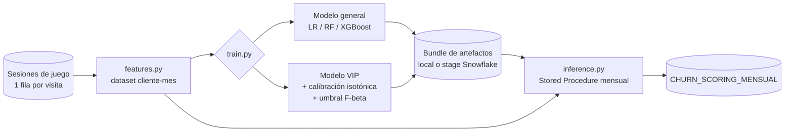

# Churn Prediction — clientes de juego (modelo general + modelo VIP)

Pipeline de machine learning para predecir, cada mes, qué clientes de un negocio de juego presencial
van a **dejar de visitar** en los próximos 30 días. Incluye un **modelo específico para el segmento VIP**,
con su propio umbral de decisión calibrado, y despliegue como **Stored Procedure en Snowflake**.

> Todo el repositorio funciona en local con **datos sintéticos** generados por el propio proyecto.
> No contiene datos reales, credenciales ni configuración de ningún entorno productivo.

---

## Qué resuelve

Un cliente de alto valor que deja de venir suele detectarse tarde: cuando el equipo de CRM se da cuenta,
ya lleva semanas sin visitar. Este proyecto genera una tabla mensual con, para cada cliente activo:

- probabilidad de churn (`PROB_CHURN_HARD`)
- predicción binaria y **segmento de riesgo** (Bajo / Medio / Alto)
- qué modelo lo ha puntuado (general o VIP)
- contexto de negocio: centro principal, segmento monetario, actividad del mes

## Arquitectura



La misma función `build_client_month_df` se usa en entrenamiento e inferencia, de modo que las
features se calculan exactamente igual en ambos (sin *training-serving skew*). Hay un test que lo verifica.

## Definición de churn

| Target | Definición |
|---|---|
| `churn_hard_30d` (**principal**) | El cliente no vuelve en los 30 días siguientes a su última sesión del mes |
| `churn_soft` | Sus sesiones del mes caen > 50 % frente a la media de los 3 meses previos |
| `churn_valor` | Su coin-in del mes cae > 50 % frente a la media de los 3 meses previos |

En entrenamiento se descartan el último mes global y los 2 últimos meses de cada cliente, porque en
los meses más recientes aún no ha pasado tiempo suficiente para observar si el cliente volvió.

## Features (grano cliente-mes)

| Familia | Ejemplos |
|---|---|
| Resultado de juego | `rtp_medio`, `rtp_min/max/std`, `ratio_advantage`, `ratio_sesiones_duras`, `racha_max_sesiones_duras` |
| Actividad | `n_sesiones_mes`, `densidad_sesiones`, `visita_unica`, `dias_entre_sesiones_medio/max`, `dias_sin_visita_fin_mes` |
| Valor | `coin_in_total`, `coin_in_medio`, `win_real_total`, `margen_casa_total` |
| Tendencia (3 meses previos) | `*_rolling3m`, `rtp_vs_mes_anterior`, `rtp_vs_rolling3m`, `tendencia_visitas_3m`, `ratio_coinIn_vs_historico` |
| Histórico | `meses_juego_total`, `ratio_visitas_vs_historico`, `meses_consecutivos_perdiendo` |
| Segmento | dummies `monetary_*` |

Una sesión es **"dura"** si su RTP < 0.90 y de **"advantage"** si RTP > 1.0. El centro principal del mes
se expone como información de negocio, pero **no** se usa como feature (alta cardinalidad y no estable).

## Modelado

1. **Split temporal** (nunca aleatorio): `train | calib (1 mes) | validación (3 meses)`.
2. **Modelo general**: Logistic Regression, Random Forest y XGBoost con `class_weight` / `scale_pos_weight`;
   se elige el mejor por AUC en validación.
3. **Modelo VIP**: los clientes VIP son minoría y el modelo general tiende a asignarles probabilidades
   muy bajas. Se entrena un modelo solo con VIP, **sin** `n_sesiones_mes` ni `densidad_sesiones`
   (dominan el modelo general pero discriminan mal en clientes de alta frecuencia), y se calibra con
   regresión isotónica sobre el bloque `calib`.
4. **Umbral VIP calibrado**: se elige el umbral que maximiza **F-beta con β = 0.5** sobre la curva
   precisión-recall del modelo VIP — modo *francotirador*: avisar de pocos clientes pero acertar en la
   mayoría. Se puede fijar a mano (`vip_threshold`) tras revisar la tabla de *trade-off*
   umbral / nº marcados / precisión / recall que imprime el entrenamiento.
5. El reporte final de validación aplica **la misma lógica de scoring que producción**
   (`churn/scoring.py`), por segmento.

| Segmento de riesgo | VIP | Resto |
|---|---|---|
| Bajo | p < 0.45 | p < 0.45 |
| Medio | 0.45 ≤ p < umbral VIP | 0.45 ≤ p ≤ 0.77 |
| Alto | p ≥ umbral VIP | p > 0.77 |

## Estructura

```
churn/
  config.py       # configuración (defaults + YAML local)
  features.py     # sesiones -> cliente-mes (compartido train/inferencia)
  train.py        # entrenamiento, calibración VIP, validación, artefactos
  scoring.py      # aplicación del bundle y umbrales por segmento
  inference.py    # scoring mensual + handler del Stored Procedure
  io.py           # lectura/escritura local y Snowflake (Snowpark)
  synthetic.py    # generador de datos sintéticos
config/config.example.yaml
scripts/deploy_snowflake.py   # sube código + config al stage
sql/                          # setup, Stored Procedure + Task, consultas de explotación
tests/test_pipeline.py
```

## Uso en local (datos sintéticos)

```bash
python -m venv .venv && source .venv/bin/activate
pip install -r requirements.txt

python -m churn.synthetic --customers 3000 --months 18     # data/sessions.parquet
python -m churn.train                                      # artifacts/ + reports/validacion.png
python -m churn.inference                                  # data/scoring.csv (último mes cerrado)
python -m churn.inference --month 202609                   # un mes concreto

pytest -q
```

## Uso con Snowflake

1. `cp config/config.example.yaml config/config.yaml` y rellena base de datos, esquema, vista origen y,
   si tus columnas se llaman distinto, el bloque `source_columns`. Pon `mode: snowflake`.
2. Define la conexión en `~/.snowflake/connections.toml` (fuera del repo) e indica su nombre en
   `snowflake_connection_name`.
3. Entrena (los artefactos se suben al stage): `python -m churn.train --config config/config.yaml`
4. Sube código y config al stage: `python scripts/deploy_snowflake.py --config config/config.yaml`
5. Crea el Stored Procedure y la Task mensual con `sql/02_stored_procedure.sql`.

La inferencia solo descarga los meses necesarios para los rolling (`inference_lookback_months`), no
todo el histórico, y escribe de forma idempotente (borra y reinserta el mes puntuado).

## Decisiones y limitaciones conocidas

- **Versiones**: el bundle guarda `sklearn_version`; el Stored Procedure debe usar la misma versión de
  scikit-learn/xgboost que el entrenamiento para deserializar los modelos.
- **Rolling por filas**: los `*_rolling3m` usan los 3 meses *con actividad* anteriores, no 3 meses de
  calendario. Para clientes con huecos largos, la ventana de inferencia puede no cubrir esos meses.
- **`meses_consecutivos_perdiendo`** depende de todo el histórico; en inferencia se calcula sobre la
  ventana cargada y puede quedar truncada en rachas muy largas.
- **Selección del modelo general en validación**: la métrica reportada del ganador es ligeramente
  optimista; la del modelo VIP, no (se selecciona y calibra en `calib`, y se evalúa en validación).
- Los resultados sobre datos sintéticos solo sirven para comprobar que el pipeline funciona;
  no son representativos del rendimiento sobre datos reales.

## Autor

David López Hernández — Data Scientist
